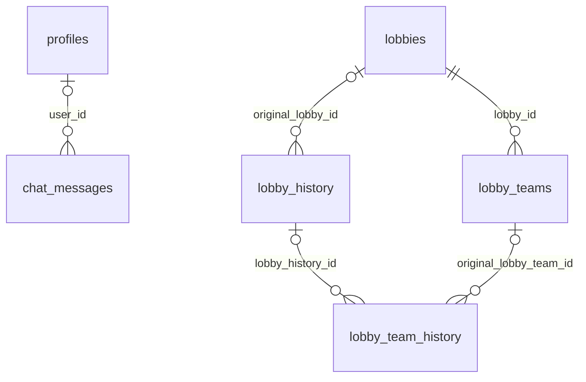

# LazarFlow — Database Schema Reference

> **Generated file.** Last generated **2026-10-30** from project `xsxwzwcfaflzynsyryzq`.
> Regenerate with `node --env-file=../LazarFlow-backend/.env --env-file=.env scripts/generate-db-schema.mjs`.
> Edit `scripts/generate-db-schema.mjs` (the `TABLE_META` map), not this file directly.

## Contents

- [Security warning](#security-warning)
- [Overview](#overview)
- [Entity relationships](#entity-relationships)
- [Identity and Access](#identity-and-access)
- [Lobbies and Tournaments](#lobbies-and-tournaments)
- [Teams and Strategy](#teams-and-strategy)
- [Themes](#themes)
- [OCR](#ocr)
- [Billing](#billing)
- [Developer Platform](#developer-platform)
- [Content and Comms](#content-and-comms)
- [Admin and Observability](#admin-and-observability)
- [RPC functions](#rpc-functions)
- [Storage buckets](#storage-buckets)
- [Known gaps](#known-gaps)
- [Drift from the old `databaseSchema.md`](#drift-from-the-old-databaseschemamd)
- [How this file was generated](#how-this-file-was-generated)

## Security warning

The admin app uses the **anon key in the browser**. At the time of the last audit, the anon key had
full `SELECT` / `INSERT` / `UPDATE` access to every table in `public` — RLS was either disabled or
permissive. Treat every table below as public until proven otherwise.

Consequences:

- `profiles.session_token`, `whatsapp_access_token`, `whatsapp_refresh_token`, `developer_profiles.password_hash`,
  `api_keys.key_hash` / `key_hint`, `expo_push_token`, `phone`, `emails` and `payments.gateway_order_id` are readable.
- Anyone can `UPDATE profiles.is_admin`, `payments.status`, `themes.status`, `api_keys.name`, `developer_profiles.status`.
- Admin screens must not rely on the anon key for authorization. Move admin reads/writes behind the backend or an Edge Function.

**Live check (2026-10-30):** the anon key can read **14 / 14** tables;
13 of those return the exact same row count as the service role.

| Table | Anon status | Anon rows | Service rows | Verdict |
| --- | ---: | ---: | ---: | --- |
| `admin_grants` | 200 | 0 | 0 | **full read** |
| `chat_messages` | 200 | 0 | 0 | **full read** |
| `game_entities` | 206 | 94 | 94 | **full read** |
| `lobbies` | 206 | 131 | 131 | **full read** |
| `lobby_history` | 206 | 178 | 178 | **full read** |
| `lobby_team_history` | 206 | 1,013 | 1,013 | **full read** |
| `lobby_teams` | 206 | 743 | 743 | **full read** |
| `logs` | 200 | 0 | 7 | partial read |
| `notifications` | 200 | 0 | 0 | **full read** |
| `ocr_jobs` | 206 | 215 | 215 | **full read** |
| `payments` | 206 | 79 | 79 | **full read** |
| `profiles` | 206 | 297 | 297 | **full read** |
| `reports` | 200 | 0 | 0 | **full read** |
| `themes` | 206 | 55 | 55 | **full read** |

> This check only covers reads. Write access (INSERT/UPDATE/DELETE) must be tested separately.

## Overview

**14 tables** in `public`, **2,812 rows** total, as of 2026-10-30.

| Domain | Tables | Rows |
| --- | ---: | ---: |
| Identity and Access | 1 | 297 |
| Lobbies and Tournaments | 4 | 2,065 |
| Themes | 1 | 55 |
| OCR | 1 | 215 |
| Billing | 1 | 79 |
| Content and Comms | 3 | 94 |
| Admin and Observability | 3 | 7 |

### Table index

| Table | Rows | Domain | Purpose |
| --- | ---: | --- | --- |
| [`profiles`](#profiles) | 297 | Identity and Access | App user profile: identity, subscription state, flux balance, push/WhatsApp tokens, single-device session. |
| [`lobbies`](#lobbies) | 131 | Lobbies and Tournaments | A tournament lobby created by an organizer. |
| [`lobby_history`](#lobby_history) | 178 | Lobbies and Tournaments | Immutable snapshot of a lobby (archive). |
| [`lobby_team_history`](#lobby_team_history) | 1,013 | Lobbies and Tournaments | Archived teams belonging to a `lobby_history` row. |
| [`lobby_teams`](#lobby_teams) | 743 | Lobbies and Tournaments | Teams registered in a lobby, with members and computed points. |
| [`themes`](#themes) | 55 | Themes | Scoreboard/render theme: image URL plus a mapping config used by the renderer. |
| [`ocr_jobs`](#ocr_jobs) | 215 | OCR | OCR extraction job (lobby processing / result extraction). |
| [`payments`](#payments) | 79 | Billing | User purchases (flux packs and subscriptions) via Razorpay. |
| [`chat_messages`](#chat_messages) | 0 | Content and Comms | WhatsApp chat history. |
| [`game_entities`](#game_entities) | 94 | Content and Comms | Game catalog (characters, pets, maps) used by LazarTrack. |
| [`reports`](#reports) | 0 | Content and Comms | User-submitted team reports. |
| [`admin_grants`](#admin_grants) | 0 | Admin and Observability | Ledger of admin-granted subscriptions and flux credits (who got what, from whom, why, balance after). |
| [`logs`](#logs) | 7 | Admin and Observability | Structured backend event feed for the admin (event/route/outcome/reason/status_code mirror the request log extras). |
| [`notifications`](#notifications) | 0 | Admin and Observability | Push-notification ledger: one row per Expo push delivered to a user. |

**Legend**

- **Null** — `NOT NULL` or `NULL` (nullable).
- **Default** — server-side default from PostgREST; `—` means no default was reported.
- **PK (inferred)** — PostgREST does not expose keys, so `id` columns are marked as the likely primary key.
- **FK** — foreign key parsed from the PostgREST column description.
- ⚠ — sensitive (secret/PII) or a known correctness problem.

> Primary keys, indexes, unique constraints, triggers and check constraints are **not** exposed by PostgREST.
> To capture them, run the generator against a Postgres connection string (see the end of this file).

## Entity relationships



Foreign keys:

- `chat_messages.user_id` → `profiles.id` _(nullable)_
- `lobby_history.original_lobby_id` → `lobbies.id` _(nullable)_
- `lobby_team_history.lobby_history_id` → `lobby_history.id` _(nullable)_
- `lobby_team_history.original_lobby_team_id` → `lobby_teams.id` _(nullable)_
- `lobby_teams.lobby_id` → `lobbies.id`

## Identity and Access

### `profiles`

**Rows:** 297

App user profile: identity, subscription state, flux balance, push/WhatsApp tokens, single-device session.

| Column | Type | Null | Default | Notes |
| --- | --- | --- | --- | --- |
| `id` | uuid | NOT NULL | — | PK (inferred) |
| `username` | text | NULL | — |  |
| `display_name` | text | NULL | — |  |
| `avatar_url` | text | NULL | — |  |
| `feature_flags` | jsonb | NOT NULL | — | jsonb: empty `{}` in all sampled rows |
| `is_admin` | boolean | NOT NULL | `false` |  |
| `created_at` | timestamptz | NOT NULL | `now()` |  |
| `updated_at` | timestamptz | NOT NULL | `now()` |  |
| `lobbies_created_count` | integer | NULL | `0` |  |
| `emails` | varchar | NULL | — | ⚠ sensitive |
| `expo_push_token` | text | NULL | — | ⚠ sensitive |
| `phone` | bigint | NULL | — | ⚠ sensitive |
| `whatsapp_access_token` | text | NULL | — | ⚠ sensitive |
| `whatsapp_refresh_token` | text | NULL | — | ⚠ sensitive |
| `flux_balance` | integer | NOT NULL | `0` |  |
| `ads_watched_count` | integer | NOT NULL | `0` |  |
| `last_ad_watched_at` | timestamptz | NULL | — |  |
| `subscription_tier` | text | NULL | `free` |  |
| `subscription_status` | text | NULL | `inactive` |  |
| `subscription_expires_at` | timestamptz | NULL | — |  |
| `active_device_id` | text | NULL | — |  |
| `device_switch_count` | integer | NOT NULL | `0` |  |
| `device_switch_reset_at` | timestamptz | NULL | — |  |
| `session_token` | text | NULL | — | ⚠ sensitive |

**Notes**

- 1:1 with `auth.users` (271 / 271, no orphans).
- `feature_flags` is `{}` for every row — no feature-flag system is in use.
- `subscription_status` does not reconcile with `subscription_expires_at` (an expired row is still `active`).
- Holds secrets and PII: `session_token`, `whatsapp_*_token`, `expo_push_token`, `phone`, `emails`.
- `id` references `auth.users.id` logically, but there is no FK constraint.

## Lobbies and Tournaments

### `lobbies`

**Rows:** 131

A tournament lobby created by an organizer.

| Column | Type | Null | Default | Notes |
| --- | --- | --- | --- | --- |
| `id` | uuid | NOT NULL | `gen_random_uuid()` | PK (inferred) |
| `user_id` | uuid | NOT NULL | — |  |
| `name` | varchar | NOT NULL | — |  |
| `game` | varchar | NOT NULL | — |  |
| `points_system` | jsonb | NOT NULL | — | jsonb array (0–13 items, 25 sampled) |
| `kill_points` | integer | NULL | `1` |  |
| `status` | varchar | NULL | `active` |  |
| `created_at` | timestamptz | NULL | `CURRENT_TIMESTAMP` |  |
| `updated_at` | timestamptz | NULL | `CURRENT_TIMESTAMP` |  |
| `final_standings` | jsonb | NULL | — | jsonb: empty `[]` in all sampled rows |
| `metadata` | jsonb | NULL | — | jsonb keys: `custom_flag`, `setup_completed` |
| `is_promoted` | boolean | NULL | `false` |  |
| `form_data` | jsonb | NULL | — | jsonb: empty `{}` in all sampled rows |

**Notes**

- `share_id`, `is_public`, `selected_template_id`, `theme`, `theme_config` no longer exist (the old schema doc was wrong).
- `final_standings` is never populated (0 / 109).
- 69 of 109 lobbies are stuck in `setup`; 37 "active" lobbies are older than 7 days.

### `lobby_history`

**Rows:** 178

Immutable snapshot of a lobby (archive).

| Column | Type | Null | Default | Notes |
| --- | --- | --- | --- | --- |
| `id` | uuid | NOT NULL | `gen_random_uuid()` | PK (inferred) |
| `original_lobby_id` | uuid | NULL | — | FK → `lobbies.id` |
| `created_by` | uuid | NULL | — |  |
| `lobby_name` | text | NULL | — |  |
| `game` | text | NULL | — |  |
| `status` | text | NULL | — |  |
| `points_system` | jsonb | NULL | — | jsonb array (5–13 items, 25 sampled) |
| `final_standings` | jsonb | NULL | — | jsonb: empty `[]` in all sampled rows |
| `analytics_snapshot` | jsonb | NULL | — | jsonb keys: `difficulty_score`, `kill_density` |
| `metadata` | jsonb | NULL | — | jsonb keys: `setup_completed` |
| `created_at` | timestamptz | NULL | `now()` |  |
| `updated_at` | timestamptz | NULL | `now()` |  |
| `kill_points` | integer | NULL | `1` |  |

**Notes**

- `original_lobby_id` points at the live `lobbies` row.

### `lobby_team_history`

**Rows:** 1,013

Archived teams belonging to a `lobby_history` row.

| Column | Type | Null | Default | Notes |
| --- | --- | --- | --- | --- |
| `id` | uuid | NOT NULL | `gen_random_uuid()` | PK (inferred) |
| `lobby_history_id` | uuid | NULL | — | FK → `lobby_history.id` |
| `original_lobby_team_id` | uuid | NULL | — | FK → `lobby_teams.id` |
| `team_id` | uuid | NULL | — |  |
| `team_name` | text | NULL | — |  |
| `members` | jsonb | NULL | — | jsonb array (0–4 items, 25 sampled) |
| `analytics_snapshot` | jsonb | NULL | — | jsonb keys: `aggression`, `balance_points`, `ratio`, `survival`, `version` |
| `metadata` | jsonb | NULL | — | jsonb: empty `{}` in all sampled rows |
| `created_at` | timestamptz | NULL | `now()` |  |
| `updated_at` | timestamptz | NULL | `now()` |  |
| `total_points` | jsonb | NULL | — | jsonb keys: `kill_points`, `matches_played`, `placement_points`, `wins` |

**Notes**

- 871 rows, no orphans.

### `lobby_teams`

**Rows:** 743

Teams registered in a lobby, with members and computed points.

| Column | Type | Null | Default | Notes |
| --- | --- | --- | --- | --- |
| `id` | uuid | NOT NULL | `gen_random_uuid()` | PK (inferred) |
| `lobby_id` | uuid | NOT NULL | — | FK → `lobbies.id` |
| `team_name` | varchar | NOT NULL | — |  |
| `created_at` | timestamptz | NULL | `CURRENT_TIMESTAMP` |  |
| `updated_at` | timestamptz | NULL | `CURRENT_TIMESTAMP` |  |
| `total_points` | jsonb | NULL | — | jsonb keys: `kill_points`, `matches_played`, `placement_points`, `wins` |
| `members` | jsonb | NULL | — | jsonb array (0–4 items, 25 sampled) |
| `respective_slotlist_postion` | integer | NOT NULL | `0` |  |
| `team_id` | uuid | NULL | — |  |

**Notes**

- `team_id` is always NULL (0 / 608) — lobby teams are not linked to the `teams` table.
- Average 0.9 members per team, so most teams have no roster.

## Themes

### `themes`

**Rows:** 55

Scoreboard/render theme: image URL plus a mapping config used by the renderer.

| Column | Type | Null | Default | Notes |
| --- | --- | --- | --- | --- |
| `id` | uuid | NOT NULL | `gen_random_uuid()` | PK (inferred) |
| `user_id` | uuid | NULL | — |  |
| `name` | text | NOT NULL | — |  |
| `url` | text | NOT NULL | — |  |
| `status` | text | NULL | `pending` |  |
| `created_at` | timestamptz | NULL | `now()` |  |
| `updated_at` | timestamptz | NULL | `now()` |  |
| `mapping_config` | jsonb | NULL | — | jsonb keys: `cells`, `extra_fields`, `scoreboard` |

**Notes**

- 15 duplicate rows across 4 URL groups (8× Yellow Monster, 6× Green Goblin, 3× Pink Perls, 2× Demo).
- Statuses: 19 `verified`, 12 `pending`, 11 `rejected`, 5 `deleted` (soft-deleted rows still present).
- Only 20 of 47 have a complete 12-cell mapping.
- `user_id` has no FK constraint (`NULL` = community theme).

## OCR

### `ocr_jobs`

**Rows:** 215

OCR extraction job (lobby processing / result extraction).

| Column | Type | Null | Default | Notes |
| --- | --- | --- | --- | --- |
| `id` | uuid | NOT NULL | `gen_random_uuid()` | PK (inferred) |
| `user_id` | uuid | NOT NULL | — |  |
| `lobby_id` | text | NOT NULL | — |  |
| `job_type` | text | NOT NULL | — |  |
| `status` | text | NOT NULL | `pending` |  |
| `result` | jsonb | NULL | — | jsonb keys: `cell_request_id`, `teams` |
| `error` | text | NULL | — |  |
| `created_at` | timestamptz | NOT NULL | `now()` |  |
| `updated_at` | timestamptz | NOT NULL | `now()` |  |
| `token_usage` | jsonb | NULL | — | jsonb keys: `cost_usd`, `input_tokens`, `output_tokens`, `total_tokens` |
| `image_urls` | jsonb | NULL | — | jsonb array (0–4 items, 25 sampled) |

**Notes**

- `lobby_id` is `text` with **no FK** — 88 jobs point at lobbies that no longer exist.
- `user_id` also has no FK constraint.
- `token_usage.cost_usd` is 0 on every successful job, so cost tracking is broken.
- 41 of 202 jobs failed (79.7% success); most failures are upstream 5xx/401 from the OCR service.

## Billing

### `payments`

**Rows:** 79

User purchases (flux packs and subscriptions) via Razorpay.

| Column | Type | Null | Default | Notes |
| --- | --- | --- | --- | --- |
| `id` | uuid | NOT NULL | `gen_random_uuid()` | PK (inferred) |
| `user_id` | uuid | NOT NULL | — |  |
| `amount` | numeric | NOT NULL | — |  |
| `currency` | text | NOT NULL | `INR` |  |
| `gateway` | text | NOT NULL | — |  |
| `gateway_order_id` | text | NOT NULL | — |  |
| `gateway_payment_id` | text | NULL | — |  |
| `tier` | text | NOT NULL | — |  |
| `status` | text | NOT NULL | `captured` |  |
| `created_at` | timestamptz | NOT NULL | `now()` |  |

**Notes**

- ⚠ `status` defaults to `captured`. Any insert that omits `status` books revenue automatically.
- 60 of 62 orders are stuck in `created` with no `gateway_payment_id`; only 2 were captured (₹3 lifetime).
- No `updated_at`, failure reason, refund, invoice or plan reference.
- `tier` is a free-form string, not an FK to a plan catalog.
- `user_id` has no FK constraint.

## Content and Comms

### `chat_messages`

**Rows:** 0

WhatsApp chat history.

| Column | Type | Null | Default | Notes |
| --- | --- | --- | --- | --- |
| `id` | uuid | NOT NULL | `gen_random_uuid()` | PK (inferred) |
| `sender_number` | text | NOT NULL | — |  |
| `user_id` | uuid | NULL | — | FK → `profiles.id` |
| `role` | text | NOT NULL | — |  |
| `content` | text | NOT NULL | — |  |
| `metadata` | jsonb | NULL | — |  |
| `created_at` | timestamptz | NULL | `now()` |  |

**Notes**

- Empty.

### `game_entities`

**Rows:** 94

Game catalog (characters, pets, maps) used by LazarTrack.

| Column | Type | Null | Default | Notes |
| --- | --- | --- | --- | --- |
| `id` | uuid | NOT NULL | `gen_random_uuid()` | PK (inferred) |
| `source_id` | text | NOT NULL | — |  |
| `entity_type` | text | NOT NULL | — |  |
| `name` | text | NOT NULL | — |  |
| `main_image` | text | NULL | — |  |
| `ability` | text | NULL | — |  |
| `ability_description` | text | NULL | — |  |
| `url` | text | NULL | — |  |
| `metadata` | jsonb | NULL | — | jsonb keys: `biography`, `quote`, `skill_icon`, `stats` |

**Notes**

- 94 rows: 65 characters, 24 pets, 5 maps.
- `source_id` is a free-form text key (numeric IDs for characters/pets, `map_*` for maps), not an FK.

### `reports`

**Rows:** 0

User-submitted team reports.

| Column | Type | Null | Default | Notes |
| --- | --- | --- | --- | --- |
| `id` | uuid | NOT NULL | `gen_random_uuid()` | PK (inferred) |
| `team_id` | uuid | NULL | — |  |
| `reported_by_name` | text | NULL | — |  |
| `reported_by_phone` | text | NULL | — | ⚠ sensitive |
| `reason` | text | NOT NULL | — |  |
| `status` | text | NULL | `pending` |  |
| `created_at` | timestamptz | NULL | `now()` |  |
| `updated_at` | timestamptz | NULL | `now()` |  |

**Notes**

- Empty. Team-oriented; not a general support/ticket queue.

## Admin and Observability

### `admin_grants`

**Rows:** 0

Ledger of admin-granted subscriptions and flux credits (who got what, from whom, why, balance after).

| Column | Type | Null | Default | Notes |
| --- | --- | --- | --- | --- |
| `id` | uuid | NOT NULL | `gen_random_uuid()` | PK (inferred) |
| `user_id` | uuid | NOT NULL | — |  |
| `granted_by` | uuid | NULL | — |  |
| `type` | text | NOT NULL | — |  |
| `amount` | integer | NULL | — |  |
| `plan_id` | text | NULL | — |  |
| `balance_after` | integer | NULL | — |  |
| `note` | text | NULL | — |  |
| `metadata` | jsonb | NOT NULL | — |  |
| `created_at` | timestamptz | NOT NULL | `now()` |  |

**Notes**

- RLS: recipients read their own grants; admins read AND write everything (FOR ALL policy, 2026-10-31).
- Created 2026-10-30 — not yet written by code; the admin grant action will record here.
- Covers manual grants only — automated flux deductions still have no ledger.

### `logs`

**Rows:** 7

Structured backend event feed for the admin (event/route/outcome/reason/status_code mirror the request log extras).

| Column | Type | Null | Default | Notes |
| --- | --- | --- | --- | --- |
| `id` | uuid | NOT NULL | `gen_random_uuid()` | PK (inferred) |
| `event` | text | NOT NULL | — |  |
| `level` | text | NOT NULL | `info` |  |
| `route` | text | NULL | — |  |
| `user_id` | uuid | NULL | — |  |
| `target_user_id` | uuid | NULL | — |  |
| `outcome` | text | NULL | — |  |
| `reason` | text | NULL | — |  |
| `status_code` | integer | NULL | — |  |
| `detail` | jsonb | NOT NULL | — | jsonb keys: `email_masked`, `logger`, `msg` |
| `created_at` | timestamptz | NOT NULL | `now()` |  |

**Notes**

- RLS: admin-only reads AND admin-only writes (FOR ALL policy, 2026-10-31) — user accepted that admins can edit/delete audit rows; the backend sink writes via service role.
- Created 2026-10-30 — sink wired 2026-10-31: policy-filtered log events batch-inserted by `service/admin_log.py`.
- `user_id` / `target_user_id` are `ON DELETE SET NULL` so the audit trail survives user deletion.

### `notifications`

**Rows:** 0

Push-notification ledger: one row per Expo push delivered to a user.

| Column | Type | Null | Default | Notes |
| --- | --- | --- | --- | --- |
| `id` | uuid | NOT NULL | `gen_random_uuid()` | PK (inferred) |
| `user_id` | uuid | NOT NULL | — |  |
| `title` | text | NOT NULL | — |  |
| `body` | text | NOT NULL | — |  |
| `data` | jsonb | NOT NULL | — |  |
| `source` | text | NOT NULL | `admin` |  |
| `sent_by` | uuid | NULL | — |  |
| `status` | text | NOT NULL | `sent` |  |
| `error` | text | NULL | — |  |
| `created_at` | timestamptz | NOT NULL | `now()` |  |

**Notes**

- RLS: users read their own rows; admins read AND write everything (FOR ALL policy, 2026-10-31).
- Created 2026-10-30 — not yet written by any code; the send endpoints gain recording in a follow-up step.
- Broadcast recording needs the route to fetch user ids alongside tokens (`get_all_user_tokens` returns tokens only).

## RPC functions

| Function |
| --- |
| `backfill_profiles_from_auth` |
| `generate_share_id` |
| `get_public_tournament` |

> All three are POST-accessible. `backfill_profiles_from_auth` is potentially mutating — verify its
> `SECURITY DEFINER` settings and grants before exposing it.

## Storage buckets

| Bucket | Public | Size limit | Allowed MIME types |
| --- | --- | --- | --- |
| `gameResults` | yes | — | — |
| `fonts` | yes | — | — |
| `logos` | yes | — | — |
| `themes` | yes | — | — |
| `whatsapp` | yes | — | — |
| `maps` | yes | — | — |

> Every bucket is public. Anything uploaded is readable by URL without auth.

## Known gaps

Tables a SaaS admin portal needs that do **not** exist yet:

| Missing | Why it matters |
| --- | --- |
| `subscriptions` | Subscription history, renewals, cancellations. Today only `profiles.subscription_*` exists. |
| `plans / prices` | A plan catalog. `payments.tier` is a free-form string (11 distinct values for 62 orders). |
| `flux_ledger` | Immutable credit/debit ledger. `profiles.flux_balance` is a mutable integer with no history; `admin_grants` (2026-10-30) covers admin-granted credits only. |
| `audit_logs (full)` | `logs` (2026-10-30) records backend events going forward; refunds and role-change actions are not yet recorded anywhere. |
| `support_tickets` | A real support queue. `reports` is empty and team-oriented. |
| `refunds` | Refunds/disputes against `payments`. |
| `webhook_events` | Razorpay webhook log for replay and debugging. |
| `invoices` | Invoice/receipt records. |
| `feature_flags` | Global flags. `profiles.feature_flags` exists but is `{}` for all rows. |
| `admin_users / roles` | Roles beyond the single `profiles.is_admin` boolean. |

Also referenced in code but missing from the database:

- `public.ad_reward_progress` — used by `LazarFlow-backend/service/database_service/rewards.py`; ad rewards currently fail with `PGRST205`.

## Drift from the old `databaseSchema.md`

The previous doc described 8 tables and is no longer accurate. Key differences:

- 14 undocumented tables now exist: `payments`, `payments_teams`, `developer_profiles`, `developer_payments`,
  `api_keys`, `api_usage_logs`, `game_entities`, `strategies`, `reports`, `beta_signups`, `tournament_teams`,
  `lobby_team_history`, `team_lobby_notifications`.
- `lobbies` lost `share_id`, `is_public`, `selected_template_id`, `theme`, `theme_config`.
- `profiles.phone` is `bigint` (not an array); `flux_balance` is `integer`; added `active_device_id`,
  `device_switch_count`, `device_switch_reset_at`, `session_token`.
- `teams` lost `owner_user_id`, `lobbies_played`, `lobbies_count`.
- `ocr_jobs.lobby_id` is `text` with no FK; `image_urls` is `jsonb`.

## How this file was generated

The generator is read-only and uses the service-role key over PostgREST:

```bash
cd LazarFlow-admin
node --env-file=../LazarFlow-backend/.env --env-file=.env \
  scripts/generate-db-schema.mjs
```

It reads `SUPABASE_URL` + `SUPABASE_SERVICE_ROLE_KEY` (required) and `SUPABASE_ANON_KEY` /
`VITE_SUPABASE_ANON_KEY` (optional, enables the live anon-exposure check).

**What it cannot see** (PostgREST limitation): RLS policies, indexes, triggers, check/unique constraints,
function bodies, grants, table ownership, storage policies. For those, run the equivalent queries over a
Postgres connection string with `pg_catalog` / `information_schema`.

### Verified against

- Project: `xsxwzwcfaflzynsyryzq`
- Generated: 2026-10-30
- Tables: 14 · Rows: 2,812
